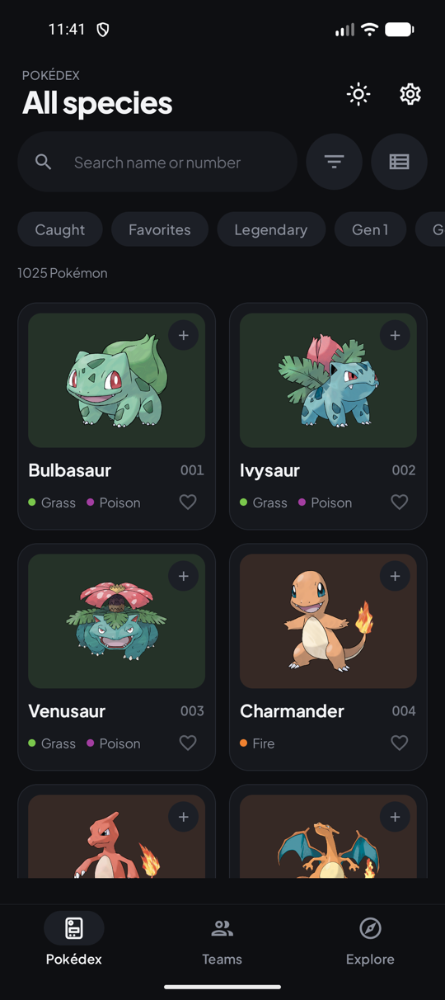
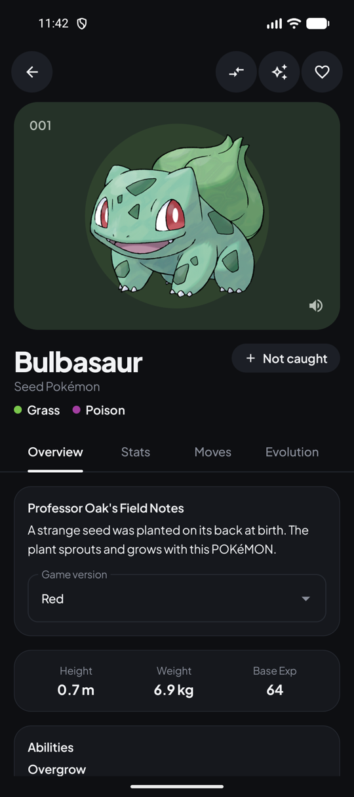
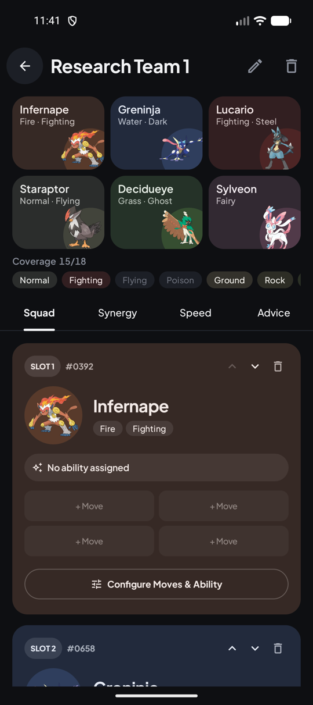
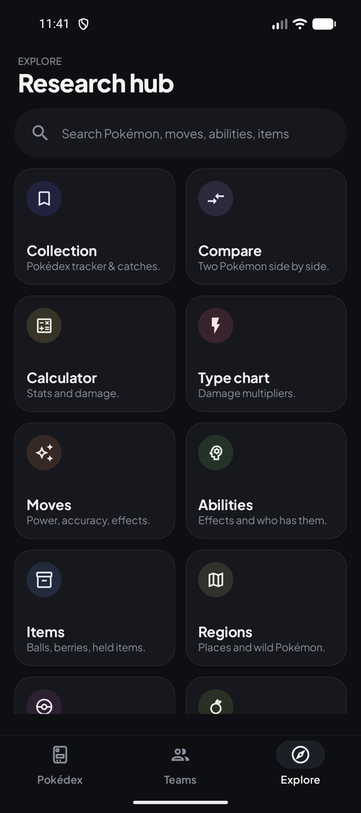
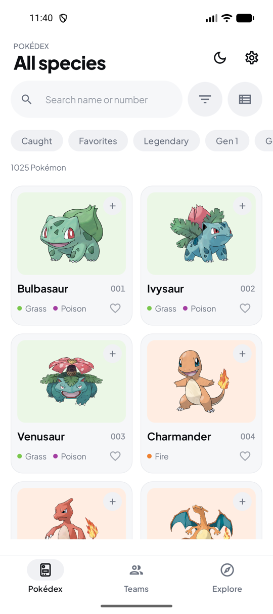
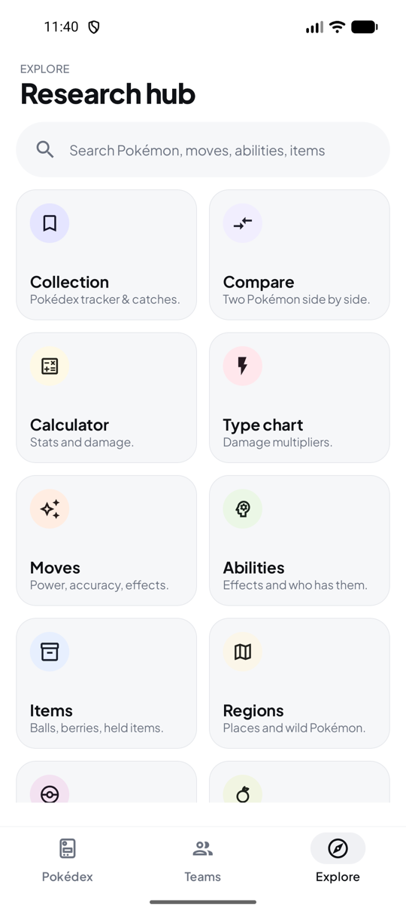
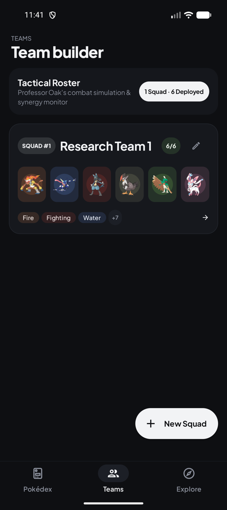

# OakLog: Pokémon Companion & Pokédex

[](https://github.com/MeetThakur/Oaklog/actions/workflows/build-apk.yml)

**OakLog** is a native Android Pokémon companion. It's a Pokédex plus a team builder, a collection tracker, and a set of research tools: type chart, calculator, evolution finder, places and wild encounters, berries, items and more. All data comes from [PokéAPI](https://pokeapi.co/) and is cached for offline use.

The look is **Graphite** (dark) and **Porcelain** (light): quiet surfaces where the artwork is the brightest thing on screen, with each Pokémon's type showing up as a soft accent.

<p align="center">
  
  
  
  
</p>
<p align="center">
  
  
  
</p>

---

## Features

### Pokédex
- All 1,025 species (Generation I to IX), as a grid or a list.
- Search by name or number (`#0025`), case-insensitive.
- Filters: generation, type, caught status, favorites, Legendary and Mythical.
- Sort by number, name, height, weight or base stat total. These fields are indexed in the background the first time you use a filter or sort that needs them.
- One-tap caught/seen status and favorites on every card.

### Pokémon page
- Artwork on a faint wash of its type, with **shiny** and **female** toggles (the female toggle appears only when the sprite differs) and the **cry** on tap.
- Overview: Pokédex entry per game, abilities with their effects, **type matchups** (weak against, resists, immune, strong against), growth rate, capture rate, gender ratio, egg groups, and the **held items** wild specimens carry, with chances per game.
- Stats with thin type-colored bars, a **Moves** tab by game and learn method, an **evolution** tree with real requirements, forms (regional, Mega, Gigantamax) and wild **locations**.
- Tapping an ability, move or item opens its full entry, including which Pokémon learn or hold it.

### Team builder
- Multiple teams of six. A **squad board** shows all six as tinted slots with a type **coverage** row that counts both members' types and the damaging moves they know.
- The member editor picks abilities from the Pokémon's real ability list and moves from its **legal learnset** (searchable, filterable by game), in four slots.
- Tabs for synergy (shared weaknesses, resistances, immunities), **speed tiers**, and plain-language **advice** such as "lacks a Ground answer".

### Collection
- Caught, seen, shiny and favorite tracking with overall and per-generation completion. Everything is stored locally in Room.

### Research hub
- **Search** across Pokémon, moves, abilities and items.
- **Compare** two Pokémon side by side, and a **stat and damage calculator** (levels, natures, IVs, EVs, STAB, effectiveness, critical hits).
- **Type chart** for any single or dual typing, defending or attacking.
- **Evolution finder:** filter every evolution by method, item or name ("what evolves with a Fire Stone").
- **Regions:** browse regions, then locations, then areas, with the wild Pokémon, level ranges and per-method rates and conditions, filterable by game.
- Databases for **moves**, **abilities**, **items** (including a held-items view), **berries**, **Poké Balls** (catch multipliers read from PokéAPI) and **natures**.

### Settings and offline
- Light, Dark or System theme, cache size and clearing, and pre-downloading a generation for offline use.

---

## Tech stack

| Area | Choice |
|---|---|
| Language | Kotlin 2.1 |
| UI | Jetpack Compose, Material 3 (Expressive APIs, 1.5 alpha) |
| Architecture | Clean Architecture, MVVM, repository pattern |
| DI | Dagger Hilt |
| Storage | Room (SQLite), Jetpack DataStore |
| Networking | Retrofit, OkHttp, kotlinx.serialization |
| Images | Coil 3 with a disk cache |
| Async | Kotlin Coroutines, StateFlow |

Build tooling: Android Gradle Plugin 8.9, Compose BOM 2025.10. `minSdk` 26, `compileSdk` 36.

### Project structure
```
app/src/main/java/com/oaklog/app/
├── data/
│   ├── local/        # Room database, DAOs, and ResourceCache (offline-first, versioned)
│   ├── prefs/        # DataStore settings
│   ├── remote/       # PokéAPI DTOs and Retrofit service
│   └── repository/   # Repository implementations and PokéAPI-to-domain mappers
├── domain/
│   ├── logic/        # Pure, unit-tested logic: TypeChart, TeamAnalyzer, TeamCoverage, StatCalc,
│   │                 # EvolutionFinder, TypeMatchups, Places, HeldItems, Learnset, PokedexQuery ...
│   ├── model/        # Domain models
│   └── repository/   # Repository contracts
├── di/               # Hilt modules
└── presentation/
    ├── theme/        # Graphite and Porcelain palettes, type tints, typography, shapes
    ├── components/   # Shared UI: cards, headers, sheets, custom OakIcons
    ├── navigation/   # NavHost, routes, shared-element transitions
    ├── pokedex/ detail/ teams/ collection/ compare/ search/ places/ settings/
    └── explore/      # Research hub and its tools
```

Notes on a few choices:
- **Offline-first cache.** API payloads are stored through `ResourceCache`, with a schema version so entries saved before a new field was added are refetched once.
- **Pure logic is tested.** Type effectiveness, team analysis, stat and damage math, evolution and berry filtering, legal moves and contrast of every type tint are covered by unit tests in `app/src/test`.
- **No hard-coded game data** where PokéAPI provides it: the type chart, ball multipliers and growth curves are derived from API responses or documented constants.

---

## Building and testing

### Prerequisites
- JDK 17
- Android SDK with platform 36

```bash
# Run the unit tests
./gradlew testDebugUnitTest

# Build the debug APK
./gradlew assembleDebug
```
The APK is written to `app/build/outputs/apk/debug/app-debug.apk`.

### Continuous integration
`.github/workflows/build-apk.yml` runs the unit tests and builds the debug APK on every push and pull request. The APK is uploaded as an artifact only when the repository is private.

---

## Attribution

- Data from [PokéAPI](https://pokeapi.co/). Sprites and artwork are loaded from the [PokéAPI sprites repository](https://github.com/PokeAPI/sprites) at runtime and are not bundled.
- Typeface: [Plus Jakarta Sans](https://fonts.google.com/specimen/Plus+Jakarta+Sans) under the SIL Open Font License (`app/src/main/assets/licenses/`).
- OakLog is an unofficial fan project. Pokémon and Pokémon character names are trademarks of Nintendo, Creatures Inc. and Game Freak. It is not affiliated with or endorsed by them.
